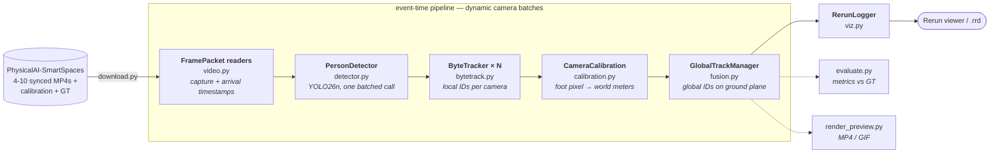
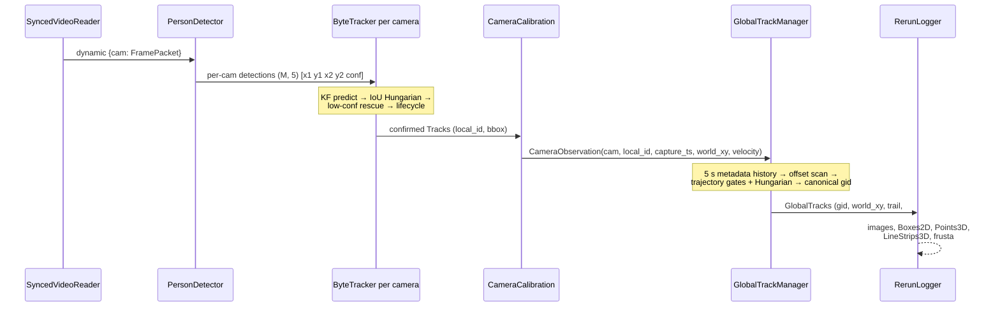

# Multi-Camera 3D People Tracking — on your laptop

[](https://www.python.org/)
[](LICENSE)
[](#performance)
[](https://docs.ultralytics.com/models/yolo26/)
[](https://rerun.io)

**Watch multiple cameras agree on who is who.** A small, readable
implementation of the technique behind NVIDIA DeepStream's
[Multi-View 3D Tracking (MV3DT)](https://docs.nvidia.com/metropolis/deepstream/dev-guide/text/DS_MV3DT.html):
people are detected and tracked in every camera, projected onto a shared
ground plane, and **fused into one global identity per person** — rendered
live as a bird's-eye view. No NVIDIA GPU, no Linux, no SDK: Python on any
laptop (Apple Silicon included). Cross-camera identity uses only timestamped
ground-plane trajectories: **no ReID model and no FaceID**.


*Same color = same person, in every camera and on the map. The data is
NVIDIA's synthetic warehouse ([PhysicalAI-SmartSpaces](https://huggingface.co/datasets/nvidia/PhysicalAI-SmartSpaces),
CC-BY-4.0) — the same scenery NVIDIA uses to demo MV3DT.*

## Table of contents

- [Why this exists](#why-this-exists)
- [Quickstart](#quickstart)
- [The live viewer](#the-live-viewer)
- [Architecture](#architecture)
- [Pipeline deep dive](#pipeline-deep-dive)
- [This repo vs. NVIDIA DeepStream MV3DT](#this-repo-vs-nvidia-deepstream-mv3dt)
- [Evaluation](#evaluation)
- [Performance](#performance)
- [Repository layout](#repository-layout)
- [Configuration reference](#configuration-reference)
- [Limitations & where to take it](#limitations--where-to-take-it)
- [Dataset & licenses](#dataset--licenses)
- [References](#references)

## Why this exists

Multi-target multi-camera (MTMC) tracking is a foundational problem in
real-time video analytics — warehouses, retail, traffic, sports. Production
stacks like DeepStream solve it impressively but run only on NVIDIA
hardware, and their pipelines are configuration-heavy, which makes the
*ideas* hard to see. This repo strips the problem to ~1,500 lines of
commented Python so you can read, run, and modify every stage yourself.

## Quickstart

Requires Python ≥ 3.11 and [uv](https://docs.astral.sh/uv/) (or plain pip).

```bash
git clone https://github.com/alexandergg/multicam-3d-tracking && cd multicam-3d-tracking
uv sync                  # install pinned dependencies
uv run download-data     # ~1.1 GB: 4 cameras + calibration + ground truth
uv run demo              # opens the live Rerun viewer
```

`demo` runs continuously on CPU until the input stream ends and, by default,
detects and tracks every decoded frame (`stride=1`). `--max-frames` is only
an optional diagnostic limit; it is not used by the normal runtime. Apple
Silicon and NVIDIA users can opt into `--device mps` or `--device cuda`.

Useful flags:

```bash
uv run download-data --full            # all 10 cameras (~2.6 GB)
uv run demo --stride 1 --device cpu --cpu-threads 4
uv run demo --save session.rrd         # record instead of opening the viewer
uv run demo --async-ingest --device cpu # independent bounded queues (default)
uv run demo --no-async-ingest --device cpu # deterministic offline lockstep replay
uv run demo-lag --delay-camera camera_0007 --delay-s 2 --jitter-s .15
uv run check-calibration --save-images # sanity-check the dataset geometry
uv run evaluate                        # metrics vs. ground truth
uv run render-preview --gif out.gif    # composite MP4/GIF like the one above
```

### Render MP4 on Modal T4

The Modal entrypoint uploads only `data/custom` plus the local model to a persistent Volume,
runs YOLO on a T4 (`device=cuda`), writes the camera-grid + BEV MP4 remotely,
and downloads the completed file to the local path given by `--out`.

Authenticate once, then use `--upload` only on the first run (or when local
input files change):

```bash
uv sync --extra modal
uv run --extra modal modal setup
uv run --extra modal modal run modal_app.py \
  --upload --seconds 20 --stride 1 --out modal-result.mp4

# Reuse the uploaded data/model on later jobs:
uv run --extra modal modal run modal_app.py \
  --seconds 60 --stride 1 --out modal-result.mp4
```

Select a subset with a comma-separated list such as
`--cameras camera_0001,camera_0007`. The persistent Modal Volume is named
`multicam-tracker-data`; remote outputs are retained under `outputs/` and are
also streamed back to the requested local `.mp4` path.

## The live viewer

One command gives you a fully interactive session — pause, scrub the
timeline, orbit the 3D world, and inspect any entity:


What you are looking at:

- **Left — world view.** The shared ground plane in meters. Each pyramid is
  a camera frustum placed from the dataset's intrinsics/extrinsics. Each
  dot is a *fused* person with their trail; the label `#67 (2 cams)` means
  global track 67 is currently corroborated by two cameras.
- **Right — camera grid.** The synchronized feeds with detection boxes
  painted in their **global** track color. When a person walks from one
  camera into another, the color and ID follow them.
- **Bottom — timeline.** Every entity is logged against the source frame
  index, so you can replay and debug any moment of the run.

## Architecture

### System overview



### Data flow per tick



### Data contracts

| Type | Producer | Shape / fields | Meaning |
|---|---|---|---|
| `FramePacket` | `video.py` | `camera`, image, `capture_ts_s`, `arrival_ts_s`, sequence, source index, quality | separates event time from transport/processing time |
| detections | `PersonDetector` | `(M, 5)` float32 `[x1, y1, x2, y2, conf]` | people found in one frame |
| `Track` | `ByteTracker` | `track_id`, Kalman box, `hits`, `misses`, `confirmed` | one person, one camera, stable local ID |
| `CameraObservation` | `demo.run_pipeline` | `camera`, `local_id`, capture time, `world_xy`, world velocity, bbox, confidence | a confirmed track projected to the floor |
| `TimedWorldPoint` | `TrackletStore` | timestamp, 2D position/velocity, confidence | metadata-only history; no image or appearance embedding |
| `GlobalTrack` | `GlobalTrackManager` | `gid`, fused Kalman `world_xy`, `trail`, supporting `cameras` | one *physical person* across all cameras |
| `affinity` | `GlobalTrackManager` | `(camera, local_id) → gid` | fusion output that lets the viewer color per-camera boxes globally |

### Key design decisions

| Decision | Choice | Rationale / trade-off |
|---|---|---|
| Fusion strategy | **Late fusion** (fuse tracks, not pixels) | Matches DeepStream MV3DT; modular, camera dropout degrades gracefully. Early fusion (BEV feature projection) is more accurate on dense scenes but monolithic. |
| Fusion topology | **Centralized** manager | One readable class. MV3DT distributes this over MQTT peers — great production property, unnecessary complexity for learning. |
| Association cost | **Trajectory only** | Position RMSE, velocity RMSE, direction, overlap and confidence. No ReID/FaceID. |
| Per-camera tracker | **Vendored ~200-line ByteTrack** | The tracker *is* course material; a dependency would hide it. Also lets one batched detector feed N trackers (libraries typically tie tracker state to model instances). |
| Detection | **One batched YOLO26n call** for all cameras | Amortizes per-call overhead exactly like DeepStream's `nvinfer` stream batching; NMS-free architecture removes a postprocessing stage. |
| Time base | **Capture event time in seconds** | Handles 1–3 s camera skew, irregular FPS, delayed arrival and clock drift; ticks remain a legacy fallback. |
| Visualization | **Rerun** | Camera grid + 3D world + timeline scrubbing in one dependency; a custom web UI would cost hundreds of lines and lose replay. |
| State estimation | **One generic constant-velocity Kalman class** | Reused at two altitudes: pixel boxes (`bytetrack.py`) and world meters (`fusion.py`) — one motion model to learn, two applications. |

### Coordinate systems

Three frames of reference, two conversions:

1. **Image plane** (pixels, per camera) — where detection and IoU tracking live.
2. **World ground plane** (meters, shared) — where fusion lives. Reached via
   each camera's 3×3 homography `H` (floor → pixels), inverted to map a
   person's *foot point* (bbox bottom-center) into meters.
3. **Full 3D world** (meters) — used only for visualization: camera frusta
   are placed from `K` (intrinsics) and `[R|t]` (extrinsics, world→camera,
   inverted to get camera pose).

## Pipeline deep dive

### 1. Timestamp-aware ingest (`video.py`, `timebase.py`)

Every image enters as a `FramePacket`. `capture_ts_s` drives Kalman motion,
timeouts and association; `arrival_ts_s` is used only to observe transport
latency. Local MP4 timestamps are derived from source frame index/FPS and
marked with an explicit quality. A live stream without usable PTS is marked
`arrival_fallback`, never silently treated as a trusted capture clock.

`SyncedVideoReader` is the deterministic dataset path. `AsyncVideoReader`
starts one reader per camera with a bounded FIFO queue and emits
dynamic micro-batches, so one stalled camera cannot block healthy streams.
The CLI enables this reader by default. A full queue pauses only its own
producer: decoded frames are never dropped to mask CPU overload. File replay
therefore runs at the measured processing throughput. Live sources can still
lose data in the upstream transport; recording the source is necessary when
every captured frame must be retained on a CPU slower than the input rate.
Known camera clock offset/scale and source-frame trims live in `PipelineConfig`.
A frame trim starts a new logical capture epoch at zero; actual residual clock
skew must be expressed separately through `camera_clock_offsets_s`.

### 2. Detection (`detector.py`)

[YOLO26](https://docs.ultralytics.com/models/yolo26/)-nano detects people
in **all cameras with one batched inference call** per tick. YOLO26 is
end-to-end (no NMS postprocessing) and runs on Apple's GPU via PyTorch
MPS, or on CPU with `--device cpu`.

### 3. Single-camera tracking (`bytetrack.py`)

Detection says *where people are*; tracking says *who is who over time*.
Each camera runs a ~200-line simplified [ByteTrack](https://arxiv.org/abs/2110.06864):

- A **constant-velocity Kalman filter** per person predicts the next box,
  so matching survives motion and missed detections.
- **Hungarian matching** on IoU associates predictions with detections.
- **Two-stage association** (ByteTrack's key idea): unmatched tracks get a
  second chance against *low-confidence* detections — which is usually
  what an occluded person looks like — rescuing tracks that a single-pass
  tracker would drop.

Per-camera IDs still fragment under long occlusions (watch the racks in
camera_0001). That's expected — and it's exactly what the next stage fixes.

### 4. From pixels to meters (`calibration.py`)

The geometric heart of the demo. Each camera ships a 3×3 **homography** H
mapping world floor coordinates (meters) to image pixels; its inverse maps
a pixel *on the floor* back to world meters. A person's bounding-box
bottom-center — their **foot point** — is (approximately) on the floor, so:

```
world_xy = H⁻¹ @ [foot_u, foot_v, 1]   (then divide by the scale term)
```

Suddenly every camera speaks the same language: positions in meters on a
shared map. `uv run check-calibration` verifies this on the dataset's
ground truth (median error ≈ 0.2 m).

> DeepStream goes further here: SV3DT fits a 3D human cylinder model using
> the full 3×4 projection matrix, which stays accurate when feet are
> occluded. And when calibration doesn't exist, its AutoMagicCalib tool
> estimates it from footage of people walking around.

### 5. Cross-camera fusion (`fusion.py`) — the interesting part

Once all tracks live on one ground plane, each local track receives a
provisional global ID immediately. The system retains only the latest five
seconds of `(timestamp, xy, velocity, confidence)` metadata and then:

1. Scans a bounded camera-level clock correction (default ±3 s), followed
   by a narrow search once the robust EWMA estimate is confident.
2. Resamples candidate trajectories at 10 Hz over their common event-time
   interval and scores position RMSE, velocity RMSE, direction and confidence.
3. Applies minimum-duration/overlap gates, Hungarian one-to-one assignment
   and a second-best margin. Overlapping local IDs from the same camera can
   never merge.
4. Merges accepted provisional IDs into the oldest canonical ID. Aliases
   are path-compressed, merging is idempotent, and late packets may repair
   identity without rewinding the live Kalman state.

This is **late fusion** — fuse *tracks*, not pixels — which is what
DeepStream MV3DT does, and it's why the system degrades gracefully: any
single camera can lose a person (occlusion, FOV exit) and the global ID
survives on the other views. The academic frontier goes the other way
(*early fusion*: project image features to the ground plane and detect
once — see [MVDet](https://arxiv.org/abs/2007.07247),
[EarlyBird](https://arxiv.org/abs/2310.13350)), trading modularity and
scalability for accuracy on dense scenes.

### 6. Visualization (`viz.py`)

[Rerun](https://rerun.io) renders the whole state in one window: camera
grid with boxes colored by *global* ID, plus a 3D world view with camera
frusta (from the dataset's intrinsics/extrinsics) and track trails. You
get pause/scrub/inspect on the timeline for free — invaluable for
debugging trackers.

## This repo vs. NVIDIA DeepStream MV3DT

| Stage | DeepStream 9.1 MV3DT | This repo |
|---|---|---|
| Hardware | NVIDIA GPU (x86 Linux / Jetson) | Any laptop (MPS / CPU) |
| Ingest | GStreamer + NVDEC, `nvstreammux` | OpenCV `VideoCapture` |
| Detection | PeopleNet Transformer / RT-DETR (TensorRT) | YOLO26n (PyTorch, batched) |
| Per-camera tracking | NvMultiObjectTracker, SV3DT 3D human model | Simplified ByteTrack (this repo) |
| Cross-camera | Distributed peers over MQTT, RMSE tracklet matching, visibility-weighted Kalman fusion | Centralized event-time tracklets + camera clock estimation + gated Hungarian + canonical IDs |
| Calibration | AutoMagicCalib (no checkerboards) | Provided by the dataset |
| Output | Kafka protobuf + OSD + BEV visualizer | Rerun viewer / .rrd / MP4 |
| Scale | 10s–100s of cameras, production | 4–10 cameras, education |

## Evaluation

`uv run evaluate` Hungarian-matches fused tracks to ground truth (1 m gate)
per frame — the pipeline under test is byte-identical to the live demo
(both consume `demo.run_pipeline`). Latest CPU verification on the current
custom 4-camera scene used the first 300 source frames (150 processed ticks),
with ground truth aligned to each configured source-frame trim:

| Metric | Value |
|---|---|
| Precision | 0.726 |
| Recall | 0.796 |
| World-plane position RMSE | 0.42 m |
| Global ID switches | 80 over 22 matched people / 150 ticks |

Recall losses concentrate at FOV edges and behind the racks — with only 4
of the 10 cameras there are blind spots. Download `--full` and re-run to
see coverage (and fusion quality) improve.

## Performance

Measured on an Apple Silicon laptop (M-series, MPS), 4×1080p streams,
`imgsz=640`, `stride=2`:

| Stage | Throughput |
|---|---|
| Detection only (batched, incl. decode) | ~78 ticks/s |
| Full pipeline incl. Rerun logging | ~37 ticks/s |
| Real-time requirement at stride 2 | 15 ticks/s |

Scaling behavior: decode cost grows linearly with camera count (CPU),
detection is one dynamic batched call (sub-linear in N). Tracklet matching
runs at 4 Hz by default, stores metadata only, and uses pairwise Hungarian
assignment. Its cost grows approximately with camera pairs × candidate
tracklet pairs × offset samples; tighten a known clock offset or lower the
match frequency for crowded CPU deployments.
The default runtime uses `device=cpu`, `stride=1` for continuous processing.
CPU inference uses up to four PyTorch threads, one OpenCV operation thread,
and one FFmpeg decoder thread per camera. `--cpu-threads` changes the PyTorch
budget without changing frames or model accuracy. Ultralytics already uses
inference mode; its device initialization callback reapplies this thread budget.

To benchmark inference, tracking and fusion separately from visualization:

```bash
uv run python benchmarks/cpu_pipeline.py --frames 300 --out data/cpu-audit/run.json
uv run python benchmarks/cpu_pipeline.py --frames 100 --profile --out data/cpu-audit/profile.json
uv run python benchmarks/state_retention.py
```

The benchmark uses the four configured default cameras and records actual
tick throughput, RSS and tracking quality. The CLI demo/evaluator/renderer
auto-discover all downloaded cameras unless `--cameras` is provided.
Retired ID aliases and local membership metadata expire with the five-second
history window; archival consumers can persist each tick's `gid_aliases` mapping.
The MP4 renderer uses source FPS and streams GIF frames to disk.

## Repository layout

```
src/multicam_tracker/
├── config.py             # every tunable, one dataclass
├── download.py           # HF dataset subset fetcher
├── calibration.py        # homographies, K/[R|t], ground truth parsing
├── timebase.py           # FramePacket and affine camera clock contract
├── video.py              # lockstep dataset + bounded async readers
├── detector.py           # batched YOLO26 wrapper
├── bytetrack.py          # Kalman filter + simplified ByteTrack
├── fusion.py             # cross-camera association — the core idea
├── tracklets.py          # 5 s history, offset estimation, trajectory matcher
├── faults.py             # delay/jitter/drop/clock-skew simulation
├── viz.py                # Rerun blueprint + logging
├── demo.py               # the pipeline as one readable loop + CLI
├── evaluate.py           # metrics vs ground truth
├── check_calibration.py  # dataset geometry sanity checks
└── render_preview.py     # composite MP4/GIF clips
```

## Configuration reference

All knobs live in `config.py` (`PipelineConfig`); the important ones:

| Knob | Default | Effect |
|---|---|---|
| `stride` | 1 | detect/track every decoded frame; values >1 explicitly skip frames |
| `conf_threshold` | 0.25 | detection floor; low values feed ByteTrack's rescue stage |
| `track_high_conf` | 0.5 | stage-1 association + track birth threshold |
| `track_max_age` | 60 ticks | legacy no-timestamp fallback (~2 s at 30 fps) |
| `track_max_age_s` | 2.0 s | timestamp-mode local-track timeout |
| `fusion_gate_m` | 2.0 m | max world distance for cross-camera association |
| `fusion_merge_m` | 1.0 m | cluster radius when grouping new observations |
| `fusion_max_age` | 90 ticks | legacy no-timestamp fallback (~3 s at 30 fps) |
| `fusion_max_age_s` | 3.0 s | timestamp-mode identity retention timeout |
| `fusion_output_grace_s` | 0.25 s | publish freshness; retained IDs are not emitted as stale people |
| `fusion_event_time_gate_s` | 0.15 s | simultaneous-geometry gate after clock correction |
| `fusion_local_reconnect_gate_m` | 1.0 m | reconnect a fragmented local ID to a retained same-camera global track |
| `fusion_min_hits` | 3 | ticks of support before a global track is shown |
| `tracklet_history_s` | 5.0 s | bounded metadata history per local ID |
| `max_camera_offset_s` | 3.0 s | coarse residual clock-offset search radius |
| `tracklet_min_duration_s` / `tracklet_min_overlap_s` | 1.0 / 0.8 s | evidence required before cross-camera merge |
| `tracklet_position_gate_m` | 0.85 m | maximum accepted trajectory position RMSE |
| `tracklet_velocity_gate_mps` | 0.90 m/s | maximum accepted trajectory velocity RMSE |
| `tracklet_match_interval_s` | 0.25 s | CPU cost/repair-latency trade-off |
| `single_person_mode` | false | optional deployment hint; safety gates remain enabled |

All timeout values with an `_s` suffix are seconds, not processed-frame
counts. The older tick knobs are used only by callers that omit timestamps.

### Fault simulation and tests

`demo-lag` delays one camera's packet arrival without changing its capture
timestamp. It can independently add timestamp offset/drift, Gaussian arrival
jitter and packet loss. This is the recommended way to validate a deployment:

```bash
uv run demo-lag --delay-camera camera_0007 --delay-s 2.0 \
  --jitter-s 0.15 --drop-rate 0.05 --clock-offset-s 1.2 --clock-drift-ppm 500
python -m unittest discover -s tests -v
python benchmarks/tracklet_matching.py
```

## Limitations & where to take it

- **Intentionally no ReID or FaceID.** Two people following an indistinguishable
  path with the same time separation are not always identifiable from geometry
  alone. One-to-one assignment, direction gates and ambiguity margins prefer
  no merge over a risky merge.
- **Foot-point occlusion.** A cut-off bounding box projects wrongly;
  SV3DT's 3D human model is the principled fix.
- **RTSP timestamp quality varies.** `AsyncVideoReader` supports independent
  sources, but production should supply hardware/NTP/PTP capture timestamps;
  arrival-time fallback is explicitly marked as lower quality.
- **Centralized fusion.** MV3DT runs fusion distributed on the cameras
  themselves (MQTT peer-to-peer) — a great systems exercise.

## Dataset & licenses

- Code: MIT.
- Data: [NVIDIA PhysicalAI-SmartSpaces](https://huggingface.co/datasets/nvidia/PhysicalAI-SmartSpaces)
  (CC-BY-4.0), downloaded at setup — not redistributed here. A synthetic
  (Isaac Sim) warehouse from the 2024 AI City Challenge MTMC track.
- Models & library: YOLO26 weights and the `ultralytics` package are
  [AGPL-3.0](https://github.com/ultralytics/ultralytics) — fine for learning
  and open source; swap the detector if you need a permissive-only stack.

## References

- NVIDIA, [Multi-View 3D Tracking in DeepStream](https://docs.nvidia.com/metropolis/deepstream/dev-guide/text/DS_MV3DT.html) · [Build a Multi-Camera 3D Tracking Application with DeepStream 9.1 Skills](https://developer.nvidia.com/blog/build-a-multi-camera-3d-tracking-application-with-nvidia-deepstream-9-1-skills/)
- Zhang et al., [ByteTrack: Multi-Object Tracking by Associating Every Detection Box](https://arxiv.org/abs/2110.06864), ECCV 2022
- Aharon et al., [BoT-SORT: Robust Associations Multi-Pedestrian Tracking](https://arxiv.org/abs/2206.14651), 2022
- Zhou et al., [Omni-Scale Feature Learning for Person Re-Identification](https://arxiv.org/abs/1905.00953) (OSNet), ICCV 2019
- Chavdarova et al., [WILDTRACK: A Multi-camera HD Dataset for Dense Unscripted Pedestrian Detection](https://openaccess.thecvf.com/content_cvpr_2018/papers/Chavdarova_WILDTRACK_A_Multi-Camera_CVPR_2018_paper.pdf), CVPR 2018
- Hou et al., [Multiview Detection with Feature Perspective Transformation](https://arxiv.org/abs/2007.07247) (MVDet), ECCV 2020
- Teepe et al., [EarlyBird: Early-Fusion for Multi-View Tracking in the Bird's Eye View](https://arxiv.org/abs/2310.13350), WACVW 2024

---

Built by [Alexander Gonzalez](https://github.com/alexandergg). If this
helped you understand multi-camera tracking, a ⭐ helps others find it.
