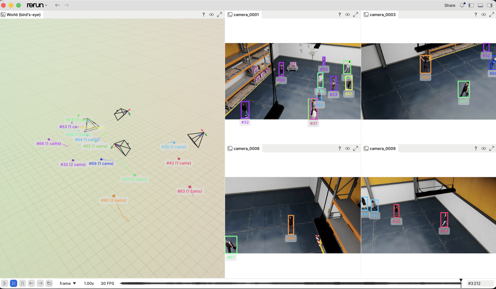
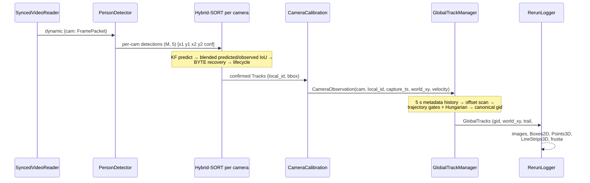

# Multi-Camera 3D People Tracking — on your laptop

[](https://www.python.org/)
[](LICENSE)
[](#performance)
[](https://docs.ultralytics.com/models/yolo26/)
[](https://rerun.io)

**Watch multiple cameras agree on who is who.** A small, readable
implementation of the technique behind NVIDIA DeepStream's
[Multi-View 3D Tracking (MV3DT)](https://docs.nvidia.com/metropolis/deepstream/dev-guide/text/DS_MV3DT.html):
people are detected and tracked in every camera, projected onto a shared
ground plane, and **fused into one global identity per person** — rendered
live as a bird's-eye view. No NVIDIA GPU, no Linux, no SDK: Python on any
laptop (Apple Silicon included). Cross-camera identity uses only timestamped
ground-plane trajectories: **no ReID model and no FaceID**.


*Same color = same person, in every camera and on the map. The data is
NVIDIA's synthetic warehouse ([PhysicalAI-SmartSpaces](https://huggingface.co/datasets/nvidia/PhysicalAI-SmartSpaces),
CC-BY-4.0) — the same scenery NVIDIA uses to demo MV3DT.*

## Table of contents

- [Why this exists](#why-this-exists)
- [Quickstart](#quickstart)
- [The live viewer](#the-live-viewer)
- [Architecture](#architecture)
- [Pipeline deep dive](#pipeline-deep-dive)
- [This repo vs. NVIDIA DeepStream MV3DT](#this-repo-vs-nvidia-deepstream-mv3dt)
- [Evaluation](#evaluation)
- [Performance](#performance)
- [Repository layout](#repository-layout)
- [Configuration reference](#configuration-reference)
- [Limitations & where to take it](#limitations--where-to-take-it)
- [Dataset & licenses](#dataset--licenses)
- [References](#references)

## Why this exists

Multi-target multi-camera (MTMC) tracking is a foundational problem in
real-time video analytics — warehouses, retail, traffic, sports. Production
stacks like DeepStream solve it impressively but run only on NVIDIA
hardware, and their pipelines are configuration-heavy, which makes the
*ideas* hard to see. This repo strips the problem to ~1,500 lines of
commented Python so you can read, run, and modify every stage yourself.

## Quickstart

Requires Python ≥ 3.11 and [uv](https://docs.astral.sh/uv/) (or plain pip).

```bash
git clone https://github.com/alexandergg/multicam-3d-tracking && cd multicam-3d-tracking
uv sync                  # install pinned dependencies
uv run download-data     # ~1.1 GB: 4 cameras + calibration + ground truth
uv run demo              # opens the live Rerun viewer
```

`demo` runs continuously on CPU until the input stream ends and, by default,
detects and tracks every decoded frame (`stride=1`). `--max-frames` is only
an optional diagnostic limit; it is not used by the normal runtime. Apple
Silicon and NVIDIA users can opt into `--device mps` or `--device cuda`.

Useful flags:

```bash
uv run download-data --full            # all 10 cameras (~2.6 GB)
uv run demo --stride 1 --device cpu --cpu-threads 4
uv run demo --save session.rrd         # record instead of opening the viewer
uv run demo --async-ingest --device cpu # independent bounded queues (default)
uv run demo --no-async-ingest --device cpu # deterministic offline lockstep replay
uv run demo-lag --delay-camera camera_0007 --delay-s 2 --jitter-s .15
uv run check-calibration --save-images # sanity-check the dataset geometry
uv run evaluate                        # metrics vs. ground truth
uv run render-preview --gif out.gif    # composite MP4/GIF like the one above
```

For a fixed population, the experimental `fixed-population-buffered` profile
keeps each new fragment under a private negative ID for 0.75 s. It publishes a
positive GID only after the fragment survives the buffer, is confirmed, and
(after the 2 s startup bootstrap) begins at an image entry/exit boundary. At
most 25 public identities are retained by default. A public identity that
disappears inside the scene remains dormant for reassociation; its slot is
released only when its last observation supplies boundary-exit evidence.

```bash
# Live CPU/Rerun, all downloaded cameras, every frame.
uv run demo --device cpu --stride 1 \
  --profile fixed-population-buffered --expected-people 25

# Local MP4 using the same identity policy.
uv run render-preview --device cpu --stride 1 --seconds 60 \
  --profile fixed-population-buffered --expected-people 25 \
  --out fixed-population.mp4
```

The effective runtime default is the No-ReID `hybridsort` profile. The
`fixed-population-buffered` and older `identity-v1-*` policies remain explicit
experiments/rollback profiles; none passed the current 4,000-tick release
gates. See [the tracking stability audit](docs/tracking-stability-audit.md).
Without ReID/FaceID, a person who
leaves and later enters at an unrelated boundary remains fundamentally
ambiguous; the fixed capacity prevents ID proliferation but cannot prove that
two disconnected trajectories belong to the same person.

### Render MP4 or evaluate MOT metrics on Modal T4

The Modal entrypoint uploads only `data/custom` plus the local model to a persistent Volume,
runs YOLO on a T4 (`device=cuda`), writes the camera-grid + BEV MP4 remotely,
and downloads the completed file to the local path given by `--out`.

Authenticate once, then use `--upload` only on the first run (or when local
input files change):

```bash
uv sync --extra modal
uv run --extra modal modal setup
uv run --extra modal modal run modal_app.py \
  --upload --seconds 20 --stride 1 --out modal-result.mp4

# Reuse the uploaded data/model on later jobs:
uv run --extra modal modal run modal_app.py \
  --seconds 60 --stride 1 --out modal-result.mp4

# Render the crowd/occlusion recovery candidate. Every run packages the latest
# local source; --upload is only needed when the data or model changes:
uv run --extra modal modal run modal_app.py \
  --seconds 60 --stride 1 \
  --tracking-profile hybridsort-crowd-recovery \
  --cameras camera_0001,camera_0007,camera_0008,camera_0010 \
  --out crowd-recovery-t4.mp4

# Render with buffered fixed-population identity allocation:
uv run --extra modal modal run modal_app.py \
  --seconds 60 --stride 1 \
  --tracking-profile fixed-population-buffered --expected-people 25 \
  --out fixed-population-modal.mp4
```

Select a subset with a comma-separated list such as
`--cameras camera_0001,camera_0007`. The persistent Modal Volume is named
`multicam-tracker-data`; remote outputs are retained under `outputs/` and are
also streamed back to the requested local `.mp4` path.

The same uploaded `data/custom` contains `ground_truth.txt`, so it can also
run IDF1/IDP/IDR, MOTA/MOTP and HOTA evaluation without another dataset
upload. Camera names must remain one comma-separated CLI argument:

```bash
# 1 minute at 30 FPS; saves the full result locally as JSON.
uv run --extra modal modal run modal_app.py \
  --evaluate --max-frames 1800 \
  --tracking-profile identity-v1-drift-guard \
  --cameras camera_0001,camera_0007,camera_0008,camera_0010 \
  --metrics-out mot-metrics-1800.json

# A longer 10-minute evaluation (subject to the available source length).
uv run --extra modal modal run modal_app.py \
  --evaluate --max-frames 9000 \
  --tracking-profile identity-v1-drift-guard \
  --cameras camera_0001,camera_0007,camera_0008,camera_0010 \
  --metric-window-frames 1000 \
  --metrics-out mot-metrics-9000.json
```

The evaluation worker has a six-hour timeout, uses `stride=1`, prints progress
every 250 processed ticks, and keeps an additional JSON copy in the Modal
Volume under `outputs/`. Use `--upload` again only when the scene or model has
changed.

## The live viewer

One command gives you a fully interactive session — pause, scrub the
timeline, orbit the 3D world, and inspect any entity:



What you are looking at:

- **Left — world view.** The shared ground plane in meters. Each pyramid is
  a camera frustum placed from the dataset's intrinsics/extrinsics. Each
  dot is a *fused* person with their trail; the label `#67 (2 cams)` means
  global track 67 is currently corroborated by two cameras.
- **Right — camera grid.** The synchronized feeds with detection boxes
  painted in their **global** track color. When a person walks from one
  camera into another, the color and ID follow them.
- **Bottom — timeline.** Every entity is logged against the source frame
  index, so you can replay and debug any moment of the run.

## Architecture

### System overview


### Data flow per tick



### Data contracts

| Type | Producer | Shape / fields | Meaning |
|---|---|---|---|
| `FramePacket` | `video.py` | `camera`, image, `capture_ts_s`, `arrival_ts_s`, sequence, source index, quality | separates event time from transport/processing time |
| detections | `PersonDetector` | `(M, 5)` float32 `[x1, y1, x2, y2, conf]` | people found in one frame |
| local `Track` | `HybridSortTracker` | `track_id`, Kalman box, raw/trusted observations, `hits`, `misses`, `confirmed`, optional appearance prototype | one person and retained identity within one camera |
| `CameraObservation` | `demo.run_pipeline` | `camera`, `local_id`, capture time, `world_xy`, world velocity, bbox, confidence, optional current appearance | an observed confirmed track projected to the floor |
| `TimedWorldPoint` | `TrackletStore` | timestamp, 2D position/velocity, confidence | metadata-only history; no image or appearance embedding |
| `GlobalTrack` | `GlobalTrackManager` | `gid`, fused Kalman `world_xy`, `trail`, supporting `cameras` | one *physical person* across all cameras |
| `affinity` | `GlobalTrackManager` | `(camera, local_id) → gid` | fusion output that lets the viewer color per-camera boxes globally |

### Key design decisions

| Decision | Choice | Rationale / trade-off |
|---|---|---|
| Fusion strategy | **Late fusion** (fuse tracks, not pixels) | Matches DeepStream MV3DT; modular, camera dropout degrades gracefully. Early fusion (BEV feature projection) is more accurate on dense scenes but monolithic. |
| Fusion topology | **Centralized** manager | One readable class. MV3DT distributes this over MQTT peers — great production property, unnecessary complexity for learning. |
| Association cost | **Trajectory-first; optional same-camera appearance** | Position RMSE, velocity RMSE, direction, overlap and confidence remain authoritative. The crowd-recovery profile uses a compact colour descriptor only to veto/tie-break ambiguous same-camera recovery; no FaceID or cross-camera ReID. |
| Per-camera tracker | **Hybrid-SORT with opt-in reappearance recovery** | Blends predicted-box IoU with last-trusted-observation IoU and uses low-confidence detections only to recover existing tracks. The crowd profile holds an ambiguous reappearance for consecutive evidence instead of immediately creating another ID. OC-SORT and ByteTrack remain explicit A/B backends. |
| Detection | **One batched YOLO26n call** for all cameras | Amortizes per-call overhead exactly like DeepStream's `nvinfer` stream batching; NMS-free architecture removes a postprocessing stage. |
| Time base | **Capture event time in seconds** | Handles 1–3 s camera skew, irregular FPS, delayed arrival and clock drift; ticks remain a legacy fallback. |
| Visualization | **Rerun** | Camera grid + 3D world + timeline scrubbing in one dependency; a custom web UI would cost hundreds of lines and lose replay. |
| State estimation | **One generic constant-velocity Kalman class** | Reused at two altitudes: pixel boxes (`ocsort.py`) and world meters (`fusion.py`); the implementation currently lives in `bytetrack.py` for backward compatibility. |

### Coordinate systems

Three frames of reference, two conversions:

1. **Image plane** (pixels, per camera) — where detection and IoU tracking live.
2. **World ground plane** (meters, shared) — where fusion lives. Reached via
   each camera's 3×3 homography `H` (floor → pixels), inverted to map a
   person's *foot point* (bbox bottom-center) into meters.
3. **Full 3D world** (meters) — used only for visualization: camera frusta
   are placed from `K` (intrinsics) and `[R|t]` (extrinsics, world→camera,
   inverted to get camera pose).

## Pipeline deep dive

### 1. Timestamp-aware ingest (`video.py`, `timebase.py`)

Every image enters as a `FramePacket`. `capture_ts_s` drives Kalman motion,
timeouts and association; `arrival_ts_s` is used only to observe transport
latency. Local MP4 timestamps are derived from source frame index/FPS and
marked with an explicit quality. A live stream without usable PTS is marked
`arrival_fallback`, never silently treated as a trusted capture clock.

`SyncedVideoReader` is the deterministic dataset path. `AsyncVideoReader`
starts one reader per camera with a bounded FIFO queue and emits
dynamic micro-batches, so one stalled camera cannot block healthy streams.
The CLI enables this reader by default. A full queue pauses only its own
producer: decoded frames are never dropped to mask CPU overload. File replay
therefore runs at the measured processing throughput. Live sources can still
lose data in the upstream transport; recording the source is necessary when
every captured frame must be retained on a CPU slower than the input rate.
Known camera clock offset/scale and source-frame trims live in `PipelineConfig`.
A frame trim starts a new logical capture epoch at zero; actual residual clock
skew must be expressed separately through `camera_clock_offsets_s`.

### 2. Detection (`detector.py`)

[YOLO26](https://docs.ultralytics.com/models/yolo26/)-nano detects people
in **all cameras with one batched inference call** per tick. YOLO26 is
end-to-end (no NMS postprocessing) and runs on Apple's GPU via PyTorch
MPS, or on CPU with `--device cpu`.

### 3. Single-camera tracking (`hybridsort.py`)

Detection says *where people are*; tracking says *who is who over time*.
Each camera runs a Hybrid-SORT tracker. Primary Hungarian
association blends IoU against the Kalman prediction with IoU against the last
trusted observation, so one statistically extreme bbox cannot silently become
the recovery anchor. A second BYTE-style round lets low-confidence detections
update existing tracks but never create new IDs. Raw/trusted observation state,
NIS outlier protection, merged-box suppression, and lost-observation prediction
are available as controlled profile switches; the latter policies remain off
in the effective default because their A/B results did not clear release gates.

The default profiles remain appearance-free. `hybridsort-crowd-recovery` is a
feature-flagged T4 candidate that adds a small three-stripe HSV descriptor,
stored as metadata rather than an image, for same-camera reappearance and
local-ID ownership checks. It is deliberately not used as cross-camera ReID
or FaceID. The stationary reconnect experiment remains separate because its
real-frame screen regressed identity metrics. Select OC-SORT or the legacy
ByteTrack backend explicitly with `--local-tracker ocsort|bytetrack`.

Per-camera IDs still fragment under long occlusions (watch the racks in
camera_0001). That's expected — and it's exactly what the next stage fixes.

### 4. From pixels to meters (`calibration.py`)

The geometric heart of the demo. Each camera ships a 3×3 **homography** H
mapping world floor coordinates (meters) to image pixels; its inverse maps
a pixel *on the floor* back to world meters. A person's bounding-box
bottom-center — their **foot point** — is (approximately) on the floor, so:

```
world_xy = H⁻¹ @ [foot_u, foot_v, 1]   (then divide by the scale term)
```

Suddenly every camera speaks the same language: positions in meters on a
shared map. `uv run check-calibration` verifies this on the dataset's
ground truth (median error ≈ 0.2 m).

> DeepStream goes further here: SV3DT fits a 3D human cylinder model using
> the full 3×4 projection matrix, which stays accurate when feet are
> occluded. And when calibration doesn't exist, its AutoMagicCalib tool
> estimates it from footage of people walking around.

### 5. Cross-camera fusion (`fusion.py`) — the interesting part

Once all tracks live on one ground plane, each local track receives a
provisional global ID immediately. The system retains only the latest five
seconds of `(timestamp, xy, velocity, confidence)` metadata and then:

1. Scans a bounded camera-level clock correction (default ±3 s), followed
   by a narrow search once the robust EWMA estimate is confident.
2. Resamples candidate trajectories at 10 Hz over their common event-time
   interval and scores position RMSE, velocity RMSE, direction and confidence.
3. Applies minimum-duration/overlap gates, Hungarian one-to-one assignment
   and a second-best margin. Overlapping local IDs from the same camera can
   never merge.
4. Merges accepted provisional IDs into the oldest canonical ID. Aliases
   are path-compressed, merging is idempotent, and late packets may repair
   identity without rewinding the live Kalman state.

This is **late fusion** — fuse *tracks*, not pixels — which is what
DeepStream MV3DT does, and it's why the system degrades gracefully: any
single camera can lose a person (occlusion, FOV exit) and the global ID
survives on the other views. The academic frontier goes the other way
(*early fusion*: project image features to the ground plane and detect
once — see [MVDet](https://arxiv.org/abs/2007.07247),
[EarlyBird](https://arxiv.org/abs/2310.13350)), trading modularity and
scalability for accuracy on dense scenes.

### 6. Visualization (`viz.py`)

[Rerun](https://rerun.io) renders the whole state in one window: camera
grid with boxes colored by *global* ID, plus a 3D world view with camera
frusta (from the dataset's intrinsics/extrinsics) and track trails. You
get pause/scrub/inspect on the timeline for free — invaluable for
debugging trackers.

## This repo vs. NVIDIA DeepStream MV3DT

| Stage | DeepStream 9.1 MV3DT | This repo |
|---|---|---|
| Hardware | NVIDIA GPU (x86 Linux / Jetson) | Any laptop (MPS / CPU) |
| Ingest | GStreamer + NVDEC, `nvstreammux` | OpenCV `VideoCapture` |
| Detection | PeopleNet Transformer / RT-DETR (TensorRT) | YOLO26n (PyTorch, batched) |
| Per-camera tracking | NvMultiObjectTracker, SV3DT 3D human model | Motion-only OC-SORT (this repo) |
| Cross-camera | Distributed peers over MQTT, RMSE tracklet matching, visibility-weighted Kalman fusion | Centralized event-time tracklets + camera clock estimation + gated Hungarian + canonical IDs |
| Calibration | AutoMagicCalib (no checkerboards) | Provided by the dataset |
| Output | Kafka protobuf + OSD + BEV visualizer | Rerun viewer / .rrd / MP4 |
| Scale | 10s–100s of cameras, production | 4–10 cameras, education |

## Evaluation

`uv run evaluate` evaluates fused world-plane tracks against ground truth.
The pipeline under test is byte-identical to the live demo (both consume
`demo.run_pipeline`). It reports three standard MOT metric families plus the
existing position diagnostics:

- Identity: IDF1, ID precision (IDP), ID recall (IDR), IDTP, IDFP and IDFN.
- CLEAR MOT: MOTA, MOTP and global ID switches (IDSW).
- HOTA: HOTA, DetA, AssA, LocA, AssPr and AssRe, averaged over the standard
  19 alpha thresholds from 0.05 through 0.95.
- World-plane detection precision/recall and position RMSE.

For point tracks, distance is converted to similarity as
`max(0, 1 - distance / match_gate_m)`. The default match gate is 1 m and can
be changed with `--match-gate-m`. Both MOTP similarity (higher is better) and
mean matched distance in metres (lower is better) are printed.

```bash
uv run evaluate --max-frames 60 --device cpu \
  --profile fixed-population-buffered --expected-people 25 \
  --cameras camera_0001 camera_0007 camera_0008 camera_0010
```

Long evaluations additionally print an IDF1/MOTA/HOTA table every 1,000
evaluated ticks. Change that interval with `--metric-window-frames`, or set it
to zero to print only the full-sequence result. Modal evaluation stores the
same window summaries in `metric_windows` in the output JSON.

The current release audit replays one continuous 4,000-tick cache for all four
cameras at `stride=1`. No candidate was promoted: the corrected
`hybridsort-balanced` reference reaches IDF1 0.2968, IDR 0.2718, HOTA 0.1948,
AssA 0.1202, precision 0.7781, recall 0.6472, 258 ID switches, and 355
fragmentations. Its cumulative IDF1 falls from 0.7017 at 500 ticks to 0.4175
at 2,000 and 0.2968 at 4,000 because the median/p95 public GIDs per GT are
9/12. Exact prediction and assignment hashes match across two independent
4,000-tick runs. Full results, stage funnel, release gates, and reproducible
commands are in [the tracking stability audit](docs/tracking-stability-audit.md).

The older 60-tick CPU smoke result below is retained as historical context; it
is not release evidence:

| Metric | Value |
|---|---|
| IDP / IDR / IDF1 | 0.772 / 0.832 / 0.801 |
| MOTA | 0.584 |
| MOTP similarity / distance | 0.761 / 0.239 m |
| HOTA | 0.626 |
| DetA / AssA / LocA | 0.484 / 0.841 / 0.829 |
| Precision / Recall | 0.773 / 0.833 |
| World-plane position RMSE | 0.308 m |
| Global ID switches | 5 over 60 ticks |
| CPU throughput | 2.11 tick/s |

The following earlier fusion ablation is also historical. It replayed identical
local observations through multiple global-association configurations on 300
source frames:

| Fusion profile | IDF1 | HOTA | MOTA | IDSW |
|---|---:|---:|---:|---:|
| `identity-v1-baseline` (rollback) | 0.705 | 0.480 | 0.594 | 39 |
| `identity-v1-drift-guard` (historical candidate) | 0.709 | 0.483 | 0.595 | 33 |
| Pre-identity-v2 | 0.703 | 0.469 | 0.542 | 42 |
| Batch reconnect only | 0.703 | 0.469 | 0.542 | 42 |
| Duplicate suppression only | 0.704 | 0.469 | 0.542 | 42 |
| Adaptive hysteresis only | 0.681 | 0.466 | 0.538 | 51 |
| Full fusion safeguards, local motion off | 0.681 | 0.467 | 0.539 | 51 |

`identity-v1-drift-guard` changes only online camera-clock learning. When
different matched people imply timestamp shifts spread by more than 0.40 s,
that camera-pair update is rejected instead of feeding an ambiguous crossing
back into later event-time association. A single trajectory, or multiple
trajectories that agree, can still learn the full ±3 s configured offset; no
appearance, ReID, FaceID, frame skipping, or fixed-population assumption is
used.

On the same 300-frame CPU evaluation, `fixed-population-buffered` retained 25
public slots and reduced ID switches from 39 to 30, but scored IDF1 0.673,
HOTA 0.438 and MOTA 0.519. Its 0.75 s publication delay plus strict
entry/capacity checks lower short-sequence recall. Use it when preventing GID
proliferation is the priority, and validate it on the full sequence before
considering it as the default profile.

The older identity-v2 candidates below were compared on a separate historical
9,000-frame Modal T4 evaluation. They missed their release gate and remain
explicit experiments. The drift-guard table is a historical 1,000-frame A/B,
not the current runtime-default decision:

| 1,000-frame profile | IDF1 | IDP | IDR | HOTA | AssA | MOTA | IDSW |
|---|---:|---:|---:|---:|---:|---:|---:|
| `identity-v1-baseline` | 0.539 | 0.484 | 0.608 | 0.346 | 0.318 | 0.523 | 181 |
| `identity-v1-drift-guard` | **0.574** | **0.517** | **0.644** | **0.359** | **0.340** | **0.530** | **161** |

The guard therefore reduced ID switches by 20 (11.0%) while improving both
identity precision and recall. On the cached 300-frame A/B it also reduced
CLEAR fragmentations from 54 to 53. The historical 9,000-frame results remain
useful evidence that the broader identity-v2 policies should not be enabled by
default:

| Profile/result | IDF1 | HOTA | AssA | IDSW | MOTA | RMSE | FP | tick/s |
|---|---:|---:|---:|---:|---:|---:|---:|---:|
| Best v1 baseline | 0.1825 | 0.1585 | 0.0715 | 1,202 | 0.4800 | 0.454 m | 67,690 | 6.44 |
| Pre-identity-v2 result | 0.1586 | 0.1522 | 0.0629 | 1,299 | 0.4867 | 0.436 m | 69,081 | 6.11 |
| `identity-full` | 0.1433 | 0.1461 | 0.0591 | 1,591 | 0.4573 | 0.438 m | 73,376 | 5.43 |
| `fusion-identity-safe` | 0.1655 | 0.1562 | 0.0662 | 1,307 | 0.4892 | 0.436 m | 68,716 | 5.92 |
| `identity-v1-safe` candidate | 0.1808 | 0.1629 | 0.0725 | 1,225 | 0.4880 | 0.439 m | 66,605 | 7.37 |

`identity-v1-safe` improved HOTA, AssA, MOTA, localization, false positives,
and speed, and reduced 1–30-frame switches from 1,115 to 1,026. It still
missed the required IDF1 (>0.1825) and IDSW (<1,202) gates, so it is retained
only as an explicit experiment. Full JSON results are in
`mot-metrics-9000-identity-v1-safe.json`,
`mot-metrics-9000-identity-safe.json`, and
`mot-metrics-9000-identity-v2.json`.

Use `benchmarks/evaluate_thresholds.py --profiles ...` for reproducible
ablation without rerunning YOLO separately for every fusion configuration.

Recall losses concentrate at FOV edges and behind the racks — with only 4
of the 10 cameras there are blind spots. Download `--full` and re-run to
see coverage (and fusion quality) improve.

## Performance

Measured on an Apple Silicon laptop (M-series, MPS), 4×1080p streams,
`imgsz=640`, `stride=2`:

| Stage | Throughput |
|---|---|
| Detection only (batched, incl. decode) | ~78 ticks/s |
| Full pipeline incl. Rerun logging | ~37 ticks/s |
| Real-time requirement at stride 2 | 15 ticks/s |

Scaling behavior: decode cost grows linearly with camera count (CPU),
detection is one dynamic batched call (sub-linear in N). Tracklet matching
runs at 4 Hz by default, stores metadata only, and uses pairwise Hungarian
assignment. Its cost grows approximately with camera pairs × candidate
tracklet pairs × offset samples; tighten a known clock offset or lower the
match frequency for crowded CPU deployments.
The default runtime uses `device=cpu`, `stride=1` for continuous processing.
CPU inference uses up to four PyTorch threads, one OpenCV operation thread,
and one FFmpeg decoder thread per camera. `--cpu-threads` changes the PyTorch
budget without changing frames or model accuracy. Ultralytics already uses
inference mode; its device initialization callback reapplies this thread budget.
The current four-camera Windows CPU audit selected four PyTorch threads:
1/2/4/8-thread runs measured 1.89/1.43/2.04/1.45 tick/s on the same 60-tick
workload with identical identity metrics. See
[the 2026-10-19 optimization audit](docs/performance-identity-optimization-2026-10-19.md).

CUDA FP16 and `torch.compile` are explicit A/B controls (`detector_fp16` and
`detector_compile`). Both remain off by default until the target GPU clears
throughput, IDF1/HOTA, IDSW, and determinism gates. CPU and MPS always use FP32.

To benchmark inference, tracking and fusion separately from visualization:

```bash
uv run python benchmarks/cpu_pipeline.py --frames 300 --out data/cpu-audit/run.json
uv run python benchmarks/cpu_pipeline.py --frames 300 \
  --tracking-profile hybridsort-balanced \
  --out data/cpu-audit/hybridsort-balanced.json
uv run python benchmarks/cpu_pipeline.py --frames 100 --profile --out data/cpu-audit/profile.json
uv run python benchmarks/cpu_pipeline.py --frames 300 --stride 2 \
  --out data/cpu-audit/stride-2.json
uv run python benchmarks/replay_cpu.py \
  --detections data/cpu-audit/detections-low-floor-4000.pkl \
  --out data/cpu-audit/fast-replay.json --only-current \
  --profile hybridsort --fast-metrics \
  --skip-stage-diagnostics --skip-memory-profile
uv run python benchmarks/state_retention.py \
  --tracking-profile hybridsort-balanced
```

For a bounded decision audit, stream fusion events and evaluator-attributed
ID switches directly to JSONL:

```bash
uv run evaluate --device cpu --max-frames 300 \
  --profile hybridsort-balanced \
  --identity-events data/cpu-audit/identity-events.jsonl \
  --cameras camera_0001 camera_0007 camera_0008 camera_0010
```

The JSONL includes local birth/match/miss/removal lifecycle data (state,
association cost, threshold, predicted/detected boxes), global
birth/publication/merge/reconnect/expiry decisions, capture/arrival/processing
timestamps, clock corrections and rejected clock updates, plus
local-fragment/crossing context for each measured ID switch.
`--identity-events-max` bounds fusion events;
the default is 250,000 and `0` explicitly means unlimited.

The benchmark uses the four configured default cameras and records actual
tick throughput, RSS and tracking quality. The CLI demo/evaluator/renderer
auto-discover all downloaded cameras unless `--cameras` is provided.
Retired ID aliases and local membership metadata expire with the five-second
history window; archival consumers can persist each tick's `gid_aliases` mapping.
The MP4 renderer uses source FPS and streams GIF frames to disk.

## Repository layout

```
src/multicam_tracker/
├── config.py             # every tunable, one dataclass
├── download.py           # HF dataset subset fetcher
├── calibration.py        # homographies, K/[R|t], ground truth parsing
├── timebase.py           # FramePacket and affine camera clock contract
├── video.py              # lockstep dataset + bounded async readers
├── detector.py           # batched YOLO26 wrapper
├── local_tracker.py      # local tracker factory (Hybrid-SORT effective default)
├── hybridsort.py         # predicted/observed-IoU Hybrid-SORT tracker
├── ocsort.py             # OCM + OCR + ORU local tracker
├── bytetrack.py          # shared Kalman + legacy ByteTrack A/B backend
├── fusion.py             # cross-camera association — the core idea
├── tracklets.py          # 5 s history, offset estimation, trajectory matcher
├── faults.py             # delay/jitter/drop/clock-skew simulation
├── viz.py                # Rerun blueprint + logging
├── demo.py               # the pipeline as one readable loop + CLI
├── evaluate.py           # metrics vs ground truth
├── mot_metrics.py        # Identity, CLEAR MOT and HOTA for world points
├── stage_diagnostics.py  # detector→local→fusion→public coverage funnel
├── check_calibration.py  # dataset geometry sanity checks
└── render_preview.py     # composite MP4/GIF clips
```

## Configuration reference

All knobs live in `config.py` (`PipelineConfig`); the important ones:

| Knob | Default | Effect |
|---|---|---|
| `stride` | 1 | detect/track every decoded frame; values >1 explicitly skip frames |
| `local_tracker` | `hybridsort` (effective profile) | per-camera backend; set `ocsort` or `bytetrack` only for rollback/A/B |
| `conf_threshold` | 0.25 | detection floor; low values feed OC-SORT's optional BYTE extension |
| `detector_fp16` | false | CUDA-only FP16 inference A/B; CPU/MPS remain FP32 |
| `detector_compile` | false | opt-in `torch.compile`; benchmark warm-up and steady state on the deployment GPU |
| `track_high_conf` | 0.5 | stage-1 association + track birth threshold |
| `track_tentative_max_misses` | 0 | misses tolerated before an unconfirmed local track is deleted; candidate profiles use 1 |
| `track_max_age` | 60 ticks | legacy no-timestamp fallback (~2 s at 30 fps) |
| `track_max_age_s` | 2.0 s | timestamp-mode local-track timeout |
| `track_kf_process_noise` / `track_kf_time_process_noise` | 2.0 / 2.0 | local Kalman acceleration variance for legacy ticks / timestamped frames |
| `track_kf_robust_nis_threshold` | 0 (off) | optionally down-weight statistically extreme bbox updates; tune against IDSW before enabling |
| `track_kf_adaptive_noise` | false | optionally scale Kalman noise with bbox height |
| `track_motion_association_enabled` | false | experimental local Mahalanobis/size/direction association; enable through `identity-full` only |
| `ocsort_delta_t` | 3 ticks | observation look-back used to estimate motion direction |
| `ocsort_inertia` | 0.10 | weight of observation-direction consistency in primary matching |
| `ocsort_use_byte` | true | allow low-confidence boxes to update an existing track, never to create one |
| `ocsort_observation_recovery_enabled` | false in `hybridsort` | OC-SORT-only last-observation recovery switch |
| `ocsort_oru_enabled` | false | optional virtual Kalman re-update; release A/B keeps it off because it reduced IDF1 |
| `ocsort_oru_min_misses` | 2 ticks | avoid rebuilding motion from a one-frame merged detection at a crossing |
| `hybridsort_ambiguity_suppression_enabled` | false | optional merged-box crossing guard; experimental because it trades recall for fewer switches |
| `hybridsort_ambiguity_min_area_ratio` | 1.10 | only classify an ambiguous box as merged when it is larger than both candidate owners |
| `fusion_gate_m` | 2.0 m | max world distance for cross-camera association |
| `fusion_merge_m` | 1.0 m | cluster radius when grouping new observations |
| `fusion_max_age` | 90 ticks | legacy no-timestamp fallback (~3 s at 30 fps) |
| `fusion_max_age_s` | 3.0 s | normal short-gap association horizon |
| `fusion_identity_retention_s` | 3.0 s | hidden identity retention; the experimental v2 profiles use 8 s |
| `fusion_output_grace_s` | 0.25 s | publish freshness; retained IDs are not emitted as stale people |
| `fusion_published_motion_gate_enabled` | false | experimental hard/soft motion policy for already-published GIDs |
| `fusion_batch_reconnect_enabled` | true in `hybridsort` | order-independent one-to-one fragment assignment |
| `fusion_provisional_buffer_enabled` | true in `hybridsort` | buffer private provisional IDs before public allocation |
| `fusion_event_time_gate_s` | 0.15 s | simultaneous-geometry gate after clock correction |
| `fusion_local_reconnect_gate_m` | 1.0 m | reconnect a fragmented local ID to a retained same-camera global track |
| `fusion_local_reconnect_window_s` | 3.0 s | default reconnect horizon; v2 uses a 1 s strict short window |
| `fusion_local_reconnect_covariance_enabled` | false | experimental 2-D NIS gate (`fusion_local_reconnect_nis_gate=9.21`) |
| `fusion_local_reconnect_confirmations` | 2 in `hybridsort` | observations required for ambiguous/long-gap reconnects |
| `fusion_local_reconnect_long_window_s` | 3.0 s | v2 can retain up to 8 s only with boundary and motion evidence |
| `fusion_boundary_margin_ratio` | 0.06 | image-edge entry/exit band used by long reconnect |
| `fusion_duplicate_merge_m` | 0.30 m in `hybridsort` | tight duplicate radius, still protected by confirmation and motion checks |
| `fusion_duplicate_confirmations` | 5 | consecutive duplicate evidence before irreversible merge |
| `fusion_instant_velocity_weight_s` | 0 (off) | optional motion re-ranking at ambiguous cross-camera merges |
| `fusion_instant_opposite_direction_cosine` | -1.1 (off) | optional opposite-direction veto; e.g. `-0.25` for a conservative crossing guard |
| `fusion_min_hits` | 3 | ticks of support before a global track is shown |
| `tracklet_history_s` | 7.0 s in `hybridsort` | bounded metadata history per local ID |
| `max_camera_offset_s` | 3.0 s | coarse residual clock-offset search radius |
| `clock_max_pair_delta_spread_s` | 0.40 s | reject inconsistent multi-person clock evidence; `identity-v1-baseline` restores the legacy unlimited value |
| `tracklet_min_duration_s` / `tracklet_min_overlap_s` | 1.0 / 0.8 s | evidence required before cross-camera merge |
| `tracklet_position_gate_m` | 0.85 m | maximum accepted trajectory position RMSE |
| `tracklet_velocity_gate_mps` | 0.90 m/s | maximum accepted trajectory velocity RMSE |
| `tracklet_match_interval_s` | 0.25 s | CPU cost/repair-latency trade-off |
| `single_person_mode` | false | optional deployment hint; safety gates remain enabled |

All timeout values with an `_s` suffix are seconds, not processed-frame
counts. The older tick knobs are used only by callers that omit timestamps.

### Detector/tracker A/B profiles

`hybridsort-balanced` is the corrected audit reference: it keeps the detector
floor/resolution (`0.25`, `640`) and lets a tentative local track survive one
missed frame. It is **not** the production default and must not be promoted:
the continuous 4,000-tick run failed the IDF1/IDR/recall, identity-churn, and
long-sequence stability gates.

`hybridsort-crossing-guard`, `hybridsort-mid-floor`,
`hybridsort-low-floor`, and `hybridsort-detect-recall` remain explicit
experiments. The crossing guard reduced switches/fragmentation at the cost of
ID recall; detector floors below `0.25` and `imgsz=768` did not beat the
baseline on the current sequence.

`hybridsort-realtime` (`imgsz=480`, confidence `0.20`) is also an explicit
speed/quality ablation, not a recommended default. On the controlled 300-tick
CPU run it improved end-to-end throughput by 26% but reduced IDF1 by 19.8%,
increased IDSW by 56%, and increased fragmentation by 154%. `stride=2`
increased source-time throughput by 52% with a 2.7% IDF1 loss. Keep the
release default at `imgsz=640`, `stride=1` when identity quality is primary.

The `hybridsort-a1-*` through `hybridsort-a5-*` profiles, including trajectory
smoothing and fixed/offset-only clock controls, are audit ablations. The A2
trajectory profile improved aggregate IDF1/HOTA but increased 4,000-tick IDSW
by 17.8% and fragmentation by 25.9%; keep it off.

Late identity binding is available in two explicit candidates. Both keep a
new fragment private for a bounded event-time window and let normal
reconnect/trajectory matching resolve it before allocating a public GID. The
offline evaluator and renderer delay only lightweight identity snapshots, so
a later canonical alias is applied to earlier frames without buffering video
images. `hybridsort-late-binding` is ID-first; the
`hybridsort-late-binding-balanced` variant permits verified interior births to
preserve recall. On the same 1,000-tick four-camera cache, the balanced variant
changed IDF1 0.6097→0.6136, HOTA 0.3623→0.3717, IDSW 66→54, fragmentation
99→82, and recall 0.7186→0.7118. It remains a candidate until a full 4,000-tick
T4 evaluation passes.

`hybridsort-crowd-recovery` extends the balanced candidate for dense groups. A
lost confirmed local identity is retained for reappearance; appearance +
geometry must win with a margin for three consecutive frames before the old
local ID is restored. At fusion level, the same-camera appearance prototype
protects an existing public GID from a recycled local ID. Stationary reconnect
is isolated in `hybridsort-crowd-stationary-reconnect` and is not composed into
the candidate after its 300-tick real-frame regression. Descriptors are compact
metadata; crops are not retained. See the
[real-frame crowd recovery audit](docs/crowd-recovery-audit-2026-10-18.md).

Identity lifetime, observation lifetime, and drawing lifetime are separate:

- `camera_tracks` / `global_tracks` contain only current observations and are
  the sole inputs to MOT metrics.
- `camera_identity_tracks` / `global_identity_tracks` also retain dormant
  identities so a short occlusion does not force a new ID.
- `camera_render_tracks` / `global_render_tracks` may draw a short predicted
  state as a dashed `OCC` track. This visual continuity never creates a scored
  detection.

```bash
uv run evaluate --profile hybridsort-balanced --max-frames 2000 \
  --metric-window-frames 500 --metrics-out mot-balanced-2000.json

uv run --extra modal modal run modal_app.py \
  --evaluate --max-frames 4000 \
  --tracking-profile hybridsort-crowd-recovery \
  --cameras camera_0001,camera_0007,camera_0008,camera_0010 \
  --metric-window-frames 500 \
  --metrics-out mot-crowd-recovery-4000.json
```

A detection cache recorded at a low confidence floor can be replayed at any
stricter floor; replay rejects attempts below the recorded floor because those
boxes are absent.

Appearance profiles must be replayed with `--video-frames`, which decodes the
exact source frame recorded by the versioned cache. Placeholder 1x1 images are
accepted only with the explicit `--allow-placeholder-frames` smoke-test flag
and must not be used to claim appearance quality.

### Fault simulation and tests

`demo-lag` delays one camera's packet arrival without changing its capture
timestamp. It can independently add timestamp offset/drift, Gaussian arrival
jitter and packet loss. This is the recommended way to validate a deployment:

```bash
uv run demo-lag --delay-camera camera_0007 --delay-s 2.0 \
  --jitter-s 0.15 --drop-rate 0.05 --clock-offset-s 1.2 --clock-drift-ppm 500
python -m unittest discover -s tests -v
python benchmarks/tracklet_matching.py
```

## Limitations & where to take it

- **Intentionally no ReID or FaceID.** Two people following an indistinguishable
  path with the same time separation are not always identifiable from geometry
  alone. One-to-one assignment, direction gates and ambiguity margins prefer
  no merge over a risky merge.
- **Foot-point occlusion.** A cut-off bounding box projects wrongly;
  SV3DT's 3D human model is the principled fix.
- **RTSP timestamp quality varies.** `AsyncVideoReader` supports independent
  sources, but production should supply hardware/NTP/PTP capture timestamps;
  arrival-time fallback is explicitly marked as lower quality.
- **Centralized fusion.** MV3DT runs fusion distributed on the cameras
  themselves (MQTT peer-to-peer) — a great systems exercise.

## Dataset & licenses

- Code: MIT.
- Data: [NVIDIA PhysicalAI-SmartSpaces](https://huggingface.co/datasets/nvidia/PhysicalAI-SmartSpaces)
  (CC-BY-4.0), downloaded at setup — not redistributed here. A synthetic
  (Isaac Sim) warehouse from the 2024 AI City Challenge MTMC track.
- Models & library: YOLO26 weights and the `ultralytics` package are
  [AGPL-3.0](https://github.com/ultralytics/ultralytics) — fine for learning
  and open source; swap the detector if you need a permissive-only stack.

## References

- NVIDIA, [Multi-View 3D Tracking in DeepStream](https://docs.nvidia.com/metropolis/deepstream/dev-guide/text/DS_MV3DT.html) · [Build a Multi-Camera 3D Tracking Application with DeepStream 9.1 Skills](https://developer.nvidia.com/blog/build-a-multi-camera-3d-tracking-application-with-nvidia-deepstream-9-1-skills/)
- Zhang et al., [ByteTrack: Multi-Object Tracking by Associating Every Detection Box](https://arxiv.org/abs/2110.06864), ECCV 2022
- Cao et al., [Observation-Centric SORT: Rethinking SORT for Robust Multi-Object Tracking](https://arxiv.org/abs/2203.14360), CVPR 2023
- Aharon et al., [BoT-SORT: Robust Associations Multi-Pedestrian Tracking](https://arxiv.org/abs/2206.14651), 2022
- Zhou et al., [Omni-Scale Feature Learning for Person Re-Identification](https://arxiv.org/abs/1905.00953) (OSNet), ICCV 2019
- Chavdarova et al., [WILDTRACK: A Multi-camera HD Dataset for Dense Unscripted Pedestrian Detection](https://openaccess.thecvf.com/content_cvpr_2018/papers/Chavdarova_WILDTRACK_A_Multi-Camera_CVPR_2018_paper.pdf), CVPR 2018
- Hou et al., [Multiview Detection with Feature Perspective Transformation](https://arxiv.org/abs/2007.07247) (MVDet), ECCV 2020
- Teepe et al., [EarlyBird: Early-Fusion for Multi-View Tracking in the Bird's Eye View](https://arxiv.org/abs/2310.13350), WACVW 2024

---

Built by [Alexander Gonzalez](https://github.com/alexandergg). If this
helped you understand multi-camera tracking, a ⭐ helps others find it.
